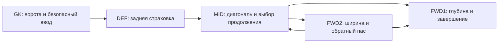

# H2: решение для No Human in the Loop

Дата проверки источников: 23 октября 2026. Исходная версия репозитория: `64235310267f2283754cba6da5df319065a9190c`.

**Рекомендация:** текущую работающую команду сохранить как A0. Следующий кандидат — согласованные пять промптов H2 на существующей Nova 2 Lite, temperature=0, maxTokens=256, extended thinking OFF. Менять модель отдельно от общего тактического контракта. Для кодовой версии: расчёт допустимых вариантов → один короткий выбор LLM → программная проверка → JSON.

**Статус:** сделаны анализ исходников, пять полных промптов, настройки, лаборатория сценариев и её локальный запуск. Не сделаны новые матчи на AWS, вызовы моделей Bedrock, установка H2 в Harness или измерение реальных задержек. Лаборатория не воспроизводит физику AWS и не доказывает вероятность победы.

## Что открыть

| Нужно | Файл |
|---|---|
| Вратарь | [prompts/gk.txt](prompts/gk.txt) |
| Защитник | [prompts/def.txt](prompts/def.txt) |
| Полузащитник | [prompts/mid.txt](prompts/mid.txt) |
| Нападающий 1 | [prompts/fwd1.txt](prompts/fwd1.txt) |
| Нападающий 2 | [prompts/fwd2.txt](prompts/fwd2.txt) |
| Настройки | [harness-settings.json](harness-settings.json) |
| Код лаборатории | [decision_lab.py](decision_lab.py) |
| Машиночитаемые результаты | [results/scenario_results.json](results/scenario_results.json) |
| Промпт выбора кандидата для Runtime | [prompts/runtime_selector.txt](prompts/runtime_selector.txt) |
| Стабильная схема выбора | [selector.schema.json](selector.schema.json) |

Пять файлов Harness — **полные системные промпты**, не дополнения к старым абзацам. Английский сохранён для согласованности с игровым контрактом. Каждый файл меньше 20 000 символов. `runtime_selector.txt` нельзя вставлять в футбольный Harness: он возвращает номер кандидата, а не игровую команду.

## 1. Исправления предыдущего анализа

**Лимит времени не установлен текущей публичной страницей.** В предоставленном материале workshop фигурировали вызовы примерно раз в 2 секунды и timeout 5 секунд. В старой справке тренера AWS указано 500 мс. Предыдущее утверждение репозитория, будто публичный сайт доказывает универсальный лимит 1 секунду, при текущей проверке не подтверждено. Не использовать 1 секунду как установленное правило. Фактический deadline нужно получить из текущего event/trace; частота вызовов и timeout — разные параметры. В конфигурации server_timeout оставлен неизвестным; P95<1500 мс — инженерная цель для первоначального опыта, не правило сервера.

**CLEAR_OVERRIDE не означает «стой».** Это возврат встроенному AI. Он может двигаться, отбирать и завершать атаки. Поэтому четыре гола при нуле SHOOT-команд нельзя автоматически считать ошибкой. Аналогично семь команд соперника не означают семь его игровых действий.

**100% Success не равно 100% правильных решений.** Нужно отдельно измерять транспорт, JSON, допустимость, применение команды и полезность эпизода. 31 SHOOT-команда и шесть ударов могут различаться из-за состояния, задержки, учёта событий или механики исполнения; отчёт не устанавливает причину.

**20 старых unit-тестов не доказывали качества тактики.** В v1 защитник возвращался к фиксированной точке приблизительно x=-33.55 даже при более глубокой угрозе. Прессингующего выбирали до исключения слишком уставших игроков: победить в выборе мог игрок, которому следующий шаг запрещает прессинг. `normalize_stamina` угадывал шкалу по значению: 1 мог означать как 100%, так и 1%. Для числовых параметров некоторые проверки пропускали Python bool. H2 проверяет соответствующие сценарии отдельно, но не заменяет существующий runtime автоматически.

## 2. Что говорят три настоящих отчёта

| Соперник | Счёт | Удары / в створ | PASS / SHOOT-команды | Средняя задержка |
|---|---|---:|---:|---:|
| Benchmark | 4:0 | 7 / 4 | 22 / 28 | 1281 мс |
| Total Attack | 0:1 | 6 / 0 | 8 / 31 | 940 мс |
| EL Real de AI | 4:0 | 5 / 4 | 0 / 0 | 843 мс |

Это 2 победы, 1 поражение, мячи 8:1. Соперники и, возможно, промпты различались; это не A/B-исследование моделей. Главный вопрос после поражения — **откуда, когда и с каким состоянием делались удары**, а не как заставить модель чаще писать SHOOT. Нельзя оптимизировать число передач ради заранее выбранной квоты. Генерируемый overview ошибочно назвал 46% владения доминированием: его причинные объяснения нужно перепроверять.

## 3. Что видят агенты и чего нельзя выдумывать

В свежем официальном fixture AWS есть все десять игроков с позицией, вектором скорости, stamina, orientation, currentAction, lastAction, speed, isSprinting; мяч имеет position, velocity, isFree и possessionAgentId. Есть tick, gameTime, score, playMode и teamChat. Это свидетельство формата образца, не гарантия полного совпадения фактического Harness input. [S1]

Позиции партнёров и соперников позволяют оценивать коридоры передач, угрозы и свободные зоны. Но агент не читает мысль другого агента и не получает будущие состояния. Скорость 0 означает в том числе «игрок стоит», а не «у него низкая максимальная скорость». Технические рейтинги passing/shooting использовать только когда они реально есть: в проверенном fixture таких рейтингов нет. Даже rating=85 не означает вероятность 85%.

Текущий запас энергии в fixture задан долями 0..1. В учебных описаниях встречается шкала 0..100; нужно явное соглашение. Не выводить шкалу из одного значения. Свободный мяч, неизвестный владелец и подтверждённое владение — три разных состояния. Дублирующиеся `agentId_3` у HOME/AWAY нельзя различать по номеру или ближайшей позиции: при смене владения координаты могут запаздывать. При неустранимой неоднозначности H2 отдаёт управление встроенному AI. Это осторожный выбор, а не исправление недостаточной наблюдаемости.

Для кодовой версии сохранять отдельные признаки `ownership_confidence`, `stamina_scale`, `observation_age`, `phase`, `role_assignment`. Это наши производные признаки; они не объявляются существующими полями AWS.

## 4. Тактика H2: один давит, остальные создают преимущество

Не предлагается постоянно высокий прессинг, тотальная оборона или владение ради владения. Предлагается компактная страховка с коротким давлением и двумя разными нападающими. Это наиболее обоснованный следующий **кандидат**, не доказанный лучший алгоритм турнира.

С мячом DEF остаётся задней опорой, MID связывает линии, FWD1 растягивает глубину, FWD2 создаёт вторую диагональ. При потере FWD2 чаще возвращается к полузащите; FWD1 сохраняет выход в контратаку. Не путать это описание с буквальным названием Formation в портале: исходную расстановку для первого сравнения оставить прежней.

Прессингующий выбирается одинаковой функцией у всех: сначала исключить неподходящих, затем учитывать дистанцию, энергию и цену потери страховки. В лаборатории используются дистанция + 10×(1−энергия) + 8 для DEF; при прямой угрозе своим воротам штраф DEF снимается. Равенство разрешается меньшим playerId. Числа являются настройкой опыта.

Один пресcингующий — ограничение на явно выдаваемые команды при одинаковом снимке. Существующие длительные overrides и встроенный AI могут продолжить другие действия; реальное исполнение и отмену требуется проверить. Разные снимки состояния также способны дать разные назначения. Не обещать атомарную координацию пяти независимых Harness.

Защитник должен быть между самой опасной угрозой и воротами, а не между фиксированной координатой и центром поля. При сопернике x=-46 для HOME точка -33.55 находится впереди угрозы; в лаборатории целевая страховка переносится за неё. Вратарь не назначается обычным прессингующим. При уже идущем разумном сейве не нужно каждую итерацию давать маленькое MOVE_TO, потенциально мешая движку.

## 5. Когда пас, удар или продвижение

Сначала законность: действительно ли этот игрок владеет мячом. Затем геометрия и продолжение.

**Пас:** свободен ли весь коридор; есть ли пространство у получателя; сможет ли он полезно продолжить; чем грозит потеря; не устарели ли позиции. Короткий GROUND — стартовый вариант. THROUGH имеет смысл для бегущего в открытое пространство партнёра. AERIAL не становится безопасным только потому, что низовая передача заблокирована. Назад пасовать не запрещено: это часто лучше потери перед своими воротами.

**Удар:** реальная 2D-дистанция, угол между стойками, блокирующие игроки, положение вратаря, доступный технический рейтинг, счёт и оставшееся время. Одинаковая x-координата у центра и боковой линии не означает одинаковую возможность. Порог 25 единиц для нападающих в промптах — начальная эвристика. Не требовать идеального момента бесконечно.

**Продвижение:** при отсутствии полезного паса и удара, но наличии свободного пространства, короткое MOVE_TO с мячом лучше бесцельной передачи. Это тоже нужно проверить в текущей механике; нет оснований считать любую дальнюю команду движения разумным дриблингом.

**Ключевой принцип:** 82% завершения передачи нельзя напрямую сравнить с 12% гола. Это разные исходы. При наличии откалиброванных вероятностей сравниваются полезности:

`U(pass) = P(complete) × V(receiver_next_state) − P(loss) × Cost(turnover)`

`U(shot) = P(goal) × Value(goal) + Value(rebound) − Cost(lost_possession)`

Без реальных данных используем порядковые оценки, а не называем их xG. Четыре функции AWS Gateway имеют вручную заданные формулы; название `success_probability` само по себе не превращает результат в подтверждённую вероятность. [S2]

Значения TL/TR/BL/BR не следует выводить из знака y без проверки отображения углов. В старом коде условие `gk.y>0 → BL` смешивало возможные вертикальные/горизонтальные значения. В H2 при неизвестном отображении используется фиксированный TR как тестовая база; доказанного оптимального угла нет.

## 6. Энергия и момент изменения тактики

Для **нормализованного** запаса энергии предлагаются стартовые диапазоны: выше 0.70 допустим полезный рывок; 0.40–0.70 — экономнее; ниже 0.40 избегать необязательных длинных погонь; ниже 0.25 не назначать добровольный прессинг. Немедленная защита ворот важнее обычного ограничения. Это не данные физического движка и не проверенная формула точности удара.

При позднем преимуществе сохранять страховку и безопасные выходы, но не загонять всю команду к вратарю. При позднем отставании снижать требования к моменту и согласованно увеличивать давление. После гола использовать новый kickoff/state, не продолжать устаревшую погоню. В code-runtime режимы следует удерживать несколько решений с гистерезисом, чтобы они не переключались туда-обратно каждую итерацию. Память режима хранится только внутри корректно выделенного матча.

## 7. Модели и конкретные параметры

### Первый проверяемый кандидат

| Поле Harness | Значение |
|---|---|
| Model source / API source | Bedrock / Bedrock, оставить существующий профиль |
| GK, DEF, MID, FWD1, FWD2 | Nova 2 Lite для первого H2-прогона |
| Temperature | 0 |
| Max tokens | 256 |
| Top P | не задавать отдельно; оставить default |
| Extended thinking | disabled |
| Stop sequences | пусто |
| Memory, Tools, Skills, Lifecycle hooks | выключены/пусты для контрольного опыта |
| Inbound Auth | существующий IAM |
| Service role | существующая `team-SolutionAccessRole-*` |

AWS рекомендует temperature=0 для структурированного вывода Nova, но прямо предупреждает о возможном отклонении от схемы. Extended thinking у Nova 2 Lite выключен по умолчанию и управляется `reasoningConfig.type`. Не вставлять произвольные API-поля в форму, если интерфейс их не поддерживает. [S3][S4]

256 — запас на завершённый JSON, не цель длины. При реальном обрезании увеличить; при нормальных ответах не нужно сокращать потолок до опасного минимума. Stop sequence `]` может убрать завершающий символ и снова дать NO_PARSE. Температура 0 не управляет физической случайностью матча и не гарантирует одинаковые ответы инфраструктуры.

### Второй модельный эксперимент

Первым альтернативным кандидатом предлагается **Claude Haiku 4.5**, если он доступен и разрешён в event account. AWS описывает его как облегчённую модель, ориентированную на скорость, и указывает поддержку нативных Structured Outputs через `bedrock-runtime`. У Nova 2 Lite эта возможность в текущей карточке отмечена как не поддерживаемая. Это функциональное различие, а не доказательство победы или меньшей задержки Haiku в данном турнире. [S5][S6]

Nova Lite — ещё один кандидат для GK/DEF. Nova Micro оставлять в списке для кодовой версии с проверкой/резервными действиями; менять на него Harness только при подтверждённом преимуществе скорости и приемлемом формате. Sonnet 4.6 использовать прежде всего для разработки, анализа трассировок и выбора тактических изменений; для игры допускать только после измерения. Самая дорогая модель не обязательно лучший контроллер.

На одинаковых **реальных** сохранённых состояниях сравнивать качество выбора, P50/P95/P99 полного ответа, обрезания, ошибки JSON, токены и успешность применения. Средние задержки трёх разных матчей не являются таким сравнением. В этом исследовании никаких вызовов сравниваемых моделей не было.

## 8. Продвинутые функции: где есть практический выигрыш

**Observability — включать первой.** Логировать конкретные факты и результат решения: кто владел мячом, какие варианты были допустимы, выбранная команда, причина делегирования, возраст снимка и latency. Не нужно сохранять скрытые рассуждения модели. Без событий исполнения команда, полученная сервером, не равна действию на поле.

**Gateway — средство подключения, не прибавка к интеллекту или точности футболиста.** Четыре реальные функции: `calculate_pass_options`, `evaluate_shot`, `find_open_space`, `get_defensive_assignment`. Их полезно изучить, улучшить и считать локально в Runtime. Последовательность LLM→Gateway→Lambda→LLM на каждом решении требует измерения и обычно усложняет бюджет задержки. Упоминание имени функции в промпте без реализации и подключения её не создаёт. [S2]

**Выбор из допустимых кандидатов.** В Runtime геометрия и ограничения формируют до шести полных команд. LLM возвращает только `{"choice":2}`. Программа проверяет, что кандидат существует и остаётся допустимым, затем сериализует игровой JSON. Это сокращает пространство ошибок и вывода. Если правила события требуют модель в каждом решении, она выбирает каждый раз; не выдавать чисто алгоритмический прототип за уже разрешённого турниром агента.

**Нативный Structured Output — только у поддерживаемой модели/API.** Для Haiku 4.5 можно исследовать постоянную маленькую схему выбора; для Nova 2 Lite нельзя обещать это по одному лишь названию параметра. Первая компиляция новой схемы Bedrock может занимать существенное время, поэтому не менять enum/схему под каждый tick. Держать постоянные IDs 0..5 и проверять доступность кандидата программно. Нативная схема гарантирует структуру в пределах возможности, а не владение мячом или правильную тактику. [S6][S7]

**Prompt caching — отдельная проверка.** У Nova 2 Lite карточка указывает минимум 1K токенов на checkpoint и TTL 5 минут; у Haiku 4.5 минимум 4096. Кешировать стабильные инструкции, не меняющееся состояние. Не раздувать промпт ради порога. Нельзя утверждать, что Harness автоматически использует нужные cache points. [S5][S6]

**Memory — короткое состояние матча прежде долгосрочной памяти.** Полезны предыдущий владелец, предыдущий пресcингующий, устойчивый тактический режим, недавние исходы действий. Не использовать прошлые матчи как текущую позицию мяча. Отсутствие включённого Memory само по себе не доказывает отсутствие session history. Без надёжного match/session ключа не хранить глобальную память, общую для разных матчей.

**Skills/hooks/custom functions.** Для первого H2 не подключать Browser, Code Interpreter и чтение больших skills на каждом тике. Геометрия должна быть подготовлена заранее или выполняться обычным кодом. Hook может проверять выход, но только после проверки доступного API, разрешений и времени; один заголовок в AWS UI ещё не даёт интеграцию с сервером игры.

## 9. Что проверила лаборатория

Запуск: `python research/v2/decision_lab.py` из корня репозитория.

Результаты сохранены в `results/scenario_results.json`:

- 20 именованных сценарных проверок: владение с дубликатами, команда владельца, GK с индексом 0, противоречивый isFree/hasBall, энергетическая шкала, уставший ближайший игрок, глубокая угроза, экстренный отбор, блокированный пас, центральный удар, плохой угол, разные коридоры нападающих и валидатор.
- 2000 случайных сцен и их зеркала: 20 000 команд для пяти игроков на двух сторонах.
- 10 000 проверок зеркальной симметрии и 10 000 независимости от порядка игроков в списке.
- Ноль недопустимых команд и ноль случаев более одного явно назначенного PRESS_BALL на одинаковом снимке.
- Упрощённое движение 120 шагов по 0.5 условной секунды, 600 обновлений игроков, без выхода за границы.

**Не проверены:** реальные голы, сейвы, отборы, влияние skill ratings, физика мяча, исполнение длительных overrides, фактическая реакция соперника, ответы Nova/Claude и их задержка. Числа не следует называть количеством сыгранных матчей, процентом побед или успешностью Harness. Лаборатория тестирует отдельную эталонную политику; не является drop-in заменой `agentic_fc.policy` и не доказывает, что LLM исполнит текстовые промпты так же.

## 10. Критическая проверка решения

| Проверка | Контраргумент | Решение |
|---|---|---|
| Всегда сильнейшая модель? | Правильное позднее решение может устареть | сравнить качество и хвост задержки |
| Всегда ближайший прессингует? | Он может быть истощён или оставлять ворота | сначала допустимость, затем стоимость |
| Получатель свободен? | Коридор передачи может быть перекрыт | проверять путь и состояние после приёма |
| Всегда больше инструментов? | Дополнительные сетевые циклы и неподтверждённые оценки | локальная геометрия, ограниченный выбор |
| Только подтверждённое владение? | При плохом payload управление часто возвращается движку | считать долю UNKNOWN; чинить наблюдаемость |
| Один пресcингующий гарантирован? | Старые overrides и built-in AI могут продолжать давление | проверять события исполнения, не только JSON |
| 20 000 проверок достаточно? | Это не модель и не физический движок | обязателен живой A/B-тест |
| Менять по одному игроку? | Разные общие правила могут конфликтовать | H2 как единый командный контракт; модели отдельно |

## 11. Внедрение без потери рабочей команды

Сохранить фактически активные пять промптов и параметры A0, а не считать ранее обсуждавшийся текст текущим. Новый общий контракт H2 испытать согласованно на пяти ролях, оставляя модели неизменными. Это один пакетный эксперимент; вклад отдельных частей затем проверять удалением одной функции за раз.

Начать с Fitness и повторов против Total Attack, где было поражение. После этого сравнить A0/H2 на трёх разных типах соперника с учётом HOME/AWAY. При возможности один прогон каждой пары — 12 матчей для первого отбора; при близких результатах нужны повторы. Держать Shout выключенным в сравнении. Не менять одновременно модель, расстановку и тактический текст.

Сохранять версия→модель→промпт→соперник→сторона→счёт→реальные удары→в створ→ошибки→P95/P99→доля UNKNOWN. Регрессия по валидности, стороне поля или защите — причина отката, даже после единичной красивой победы.

**Немедленный практический выбор:** H2 + Nova 2 Lite + temperature 0 + 256 tokens + thinking OFF, без новых сетевых инструментов. **Следующий более сильный архитектурный кандидат:** реальные данные → локальные оценки/правила → короткий выбор Haiku 4.5 с нативной схемой, если доступен и проходит измерения → программный JSON. Победу нужно подтвердить матчами; конфигурация не выдаётся за уже победившую.

## Источники и границы

[S1] AWS fixture: https://github.com/aws-samples/sample-ai-possibilities/blob/main/agentic-football-sample-agents/lib/test_helpers.py

[S2] AWS Gateway tools: https://github.com/aws-samples/sample-ai-possibilities/tree/main/agentic-football-sample-agents/ai-team-strands-gateway/gateway_tools

[S3] Nova structured prompting: https://docs.aws.amazon.com/nova/latest/userguide/prompting-structured-output.html

[S4] Nova 2 extended thinking: https://docs.aws.amazon.com/nova/latest/nova2-userguide/extended-thinking.html

[S5] Nova 2 Lite model card: https://docs.aws.amazon.com/bedrock/latest/userguide/model-card-amazon-nova-2-lite.html

[S6] Haiku 4.5 model card: https://docs.aws.amazon.com/bedrock/latest/userguide/model-card-anthropic-claude-haiku-4-5.html

[S7] Bedrock structured outputs: https://docs.aws.amazon.com/bedrock/latest/userguide/structured-output.html

[S8] Nova 2 parameters: https://docs.aws.amazon.com/nova/latest/nova2-userguide/using-converse-api.html

[S9] Current public event page, which does not establish the previously claimed 1-second deadline: https://agenticfootballcup.com/

Использованы также три пользовательских отчёта, предоставленные материалы Football Strategies / Building an Agentic System / Gateway, скриншоты настроек и исходники репозитория в указанном commit. Закрытый сервер игры и текущие private AWS traces не были получены. Старые документы проекта сохранены как история; при расхождении по срокам и поддержке моделей этот H2-разбор заменяет прежние предположения.
